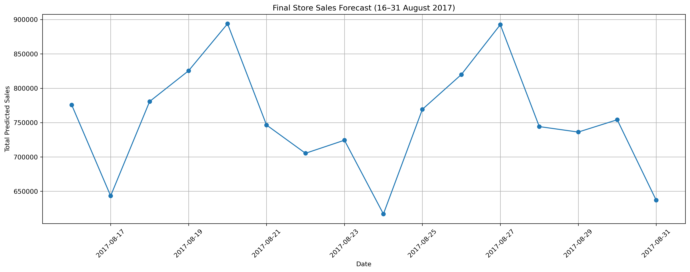

<div align="center">

# 📈 Store Sales – Time Series Forecasting

### Predicting Future Retail Sales with Machine Learning

**Future Interns | Machine Learning Internship | Task 1**


</div>

---

## 📌 Project Overview

Accurate sales forecasting helps retail businesses plan inventory, manage promotions, and make informed operational decisions.

**Store Sales – Time Series Forecasting** is a machine learning project based on the Kaggle Store Sales dataset. It uses historical sales patterns and supporting information to predict future sales across stores and product families.

The project covers data exploration, preprocessing, time-based feature engineering, model training, validation, and future sales prediction.

> **Project Goal:** Build and evaluate a machine learning forecasting model and generate sales predictions for the 16-day test period.

---

## 🎯 Project Objectives

- Explore historical retail sales patterns and trends.
- Understand the impact of promotions, holidays, oil prices, and store information.
- Create meaningful calendar and historical lag features.
- Train a machine learning regression model for sales forecasting.
- Compare model performance with a seasonal naive baseline.
- Generate predictions for the future test period.

---

## 🛠️ Tools & Technologies

| Tool / Technology | Application |
|---|---|
| Python | Core programming |
| Pandas & NumPy | Data manipulation and numerical operations |
| Matplotlib & Seaborn | Exploratory data analysis and visualizations |
| Scikit-learn | Model training and evaluation |
| Jupyter Notebook | Development and experimentation |
| HistGradientBoostingRegressor | Machine learning forecasting model |

---

## 📂 Dataset Information

**Dataset:** Store Sales – Time Series Forecasting

**Source:** [Kaggle Competition – Store Sales](https://www.kaggle.com/competitions/store-sales-time-series-forecasting)

The dataset contains historical sales information for stores and product families, along with supporting data such as promotions, transactions, holidays, oil prices, and store metadata.

### Dataset Highlights

| Detail | Information |
|---|---:|
| Training records | 3,000,888 |
| Test records | 28,512 |
| Stores | 54 |
| Product families | 33 |

The original Kaggle datasets are not included in this repository. Download the competition data from the source linked above to reproduce the notebook.

---

## ⚙️ Project Workflow

1. Data loading and exploration
2. Data quality checks and preprocessing
3. Date-based feature engineering
4. Oil price data integration
5. Store information integration
6. Holiday feature engineering
7. Historical sales lag features (7, 14, and 28 days)
8. Time-based training and validation
9. Machine learning model training
10. Recursive sales forecasting
11. Model evaluation against a baseline
12. Final prediction CSV generation

---

## 🤖 Machine Learning Model

### HistGradientBoostingRegressor

A gradient boosting regression model was used to learn patterns from historical sales and supporting features.

The model uses 27 predictive features, including:

- Historical sales lag features
- Promotion information
- Store characteristics
- Oil prices
- Holiday information
- Calendar and date-related features

---

## 📊 Model Evaluation

The model was evaluated against a **7-Day Seasonal Naive** forecasting baseline using a time-based validation period.

| Evaluation Metric | Regression Model | Seasonal Naive |
|---|---:|---:|
| RMSLE | **0.4617** | 0.6170 |
| RMSE | **269.48** | 348.38 |
| MAE | **79.56** | 96.54 |

<badge color="success">25.18% lower RMSLE</badge>

The HistGradientBoostingRegressor achieved a 25.18% lower RMSLE than the seasonal naive baseline on the validation period. Lower values indicate better performance for all three reported metrics.

---

## 📈 Visualizations

The following charts illustrate the model's validation performance and the final forecast.

### 1. Actual vs Predicted Daily Sales


### 2. Final 16-Day Sales Forecast



---

## 🔮 Final Forecast Results

| Forecast Detail | Result |
|---|---:|
| Forecast Period | 16–31 August 2017 |
| Total Predictions | 28,512 |
| Total Forecasted Sales | 12,065,729.46 |
| Average Daily Forecast | 754,108.09 |

The final predictions are saved in **submission.csv**.

---

## 💡 Key Findings

- Historical sales patterns and lag features provide useful information for forecasting.
- Promotions, holidays, store characteristics, and oil prices were included as supporting predictive features.
- The machine learning model outperformed the 7-day seasonal naive baseline on the validation period.
- The final forecasting pipeline generated 28,512 predictions for the test period.

---

## 🚀 Business Applications

| Area | Potential Business Value |
|---|---|
| Inventory Planning | Use expected sales to support stock planning. |
| Promotion Planning | Understand sales patterns around promotional periods. |
| Store Operations | Compare expected demand across stores and product families. |
| Resource Allocation | Use forecasts to support staffing and operational planning. |
| Decision Making | Support planning with data-driven sales estimates. |

---

## 📁 Project Structure

```text
FUTURE_ML_01/
│
├── README.md
├── Store_Sales_Forecasting.ipynb
├── submission.csv
├── Actual_vs_Predicted_Daily_Sales.png
├── Final_16_Day_Sales_Forecast.png
└── Store_Sales_Forecasting_Cover.png
```

---

## 📦 Project Deliverables

| Deliverable | File |
|---|---|
| Jupyter Notebook | `Store_Sales_Forecasting.ipynb` |
| Final Predictions | `submission.csv` |
| Actual vs Predicted Chart | `Actual_vs_Predicted_Daily_Sales.png` |
| Forecast Visualization | `Final_16_Day_Sales_Forecast.png` |
| Project Cover | `Store_Sales_Forecasting_Cover.png` |
| Project Documentation | `README.md` |

---

## 🏁 Conclusion

This project demonstrates how historical retail data and machine learning can be used to forecast future sales. Through feature engineering, time-based validation, and model comparison, the HistGradientBoostingRegressor achieved better validation performance than the 7-day seasonal naive baseline.

The final model generated 28,512 sales predictions for the 16–31 August 2017 test period. These forecasts can support retail planning, inventory management, and data-driven business decisions.

**Key Takeaway:** Reliable sales forecasting combines historical patterns, relevant business information, and careful time-based model evaluation.

---

## 👩‍💻 About the Author

<div align="center">

### **Simran Bhasin**

**Aspiring Data Analyst | Machine Learning & Data Science Enthusiast**

[](https://github.com/simranbhasin310)

[](https://www.linkedin.com/in/simranbhasin310/)

[](https://simranbhasin310.github.io/)

[](mailto:simranbhasin310@gmail.com)

</div>

---

<div align="center">

**Future Interns | Machine Learning Internship**

*Task 1 – Store Sales Time Series Forecasting*

⭐ If you found this project useful, consider giving the repository a star!

**Thank You for Visiting! 💙**

</div>
