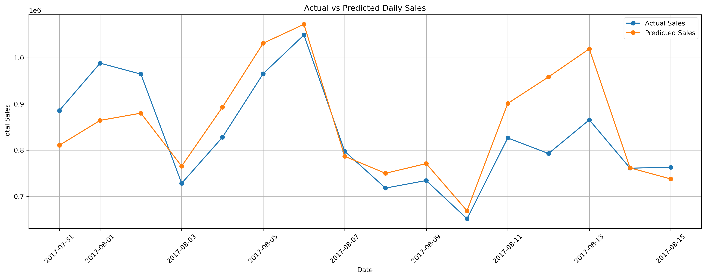

# 📊 Store Sales – Time Series Forecasting

**Future Interns | Machine Learning Internship | Task 1**

## 📌 Project Overview

This project focuses on forecasting daily sales for different stores and product families using historical sales patterns and machine learning regression techniques.

The project uses the Kaggle Store Sales – Time Series Forecasting dataset to analyze sales trends, engineer time-based features, and predict future store sales.

## 🎯 Objectives

- Analyze historical store sales patterns.
- Explore seasonal and time-based trends.
- Engineer meaningful forecasting features.
- Build and evaluate a regression-based forecasting model.
- Forecast sales for a 16-day future period.

## 🛠️ Tools & Technologies

- Python
- Pandas and NumPy
- Matplotlib and Seaborn
- Scikit-learn
- Jupyter Notebook
- Machine Learning – Regression

## 📂 Dataset

**Source:** [Kaggle – Store Sales: Time Series Forecasting](https://www.kaggle.com/competitions/store-sales-time-series-forecasting)

The dataset contains:

- 3,000,888 training records
- 28,512 test records
- 54 stores
- 33 product families

Supporting datasets include store information, oil prices, holidays and transactions.

## ⚙️ Project Workflow

1. Data loading and exploration
2. Data quality checks and preprocessing
3. Date-based feature engineering
4. Oil price integration
5. Store information integration
6. Holiday feature engineering
7. Historical sales lag features (7, 14 and 28 days)
8. Time-based training and validation
9. Regression model training
10. Recursive sales forecasting
11. Model evaluation and comparison
12. Final prediction CSV generation

## 🤖 Machine Learning Model

**HistGradientBoostingRegressor**

The model uses 27 predictive features, including historical sales lags, promotions, store characteristics, oil prices, holidays and calendar information.

## 📈 Model Evaluation

The model was evaluated against a 7-day Seasonal Naive forecasting baseline.

| Metric | Regression Model | Seasonal Naive |
| ------ | ---------------- | -------------- |
| RMSLE  | 0.4617           | 0.6170         |
| RMSE   | 269.48           | 348.38         |
| MAE    | 79.56            | 96.54          |

The regression model achieved a **25.18% lower RMSLE** than the baseline on the validation period.

## 📊 Visualizations

### Actual vs Predicted Sales



### Final 16-Day Sales Forecast


## 🔮 Final Forecast Results

- Forecast Period: 16–31 August 2017
- Total Predictions: 28,512
- Total Forecasted Sales: 12,065,729.46
- Average Daily Forecast: 754,108.09

## 📁 Project Files

```text
FUTURE_ML_01/
│
├── Store_Sales_Forecasting.ipynb
├── submission.csv
├── Actual_vs_Predicted_Daily_Sales.png
├── Final_16_Day_Sales_Forecast.png
└── README.md
```

The original Kaggle datasets are not included in this repository. Download them from the source linked above to reproduce the notebook.

## 👩‍💻 Author

**Simran Bhasin**

- GitHub: [simranbhasin310](https://github.com/simranbhasin310/)
- LinkedIn: [Simran Bhasin](https://www.linkedin.com/in/simranbhasin310/)
- Portfolio: [My Portfolio](https://github.com/simranbhasin310/SimranBhasin310.github.io)
- Email: [simranbhasin310@gmail.com](mailto:simranbhasin310@gmail.com)

---

*Submitted as part of the Future Interns Machine Learning Internship.*
